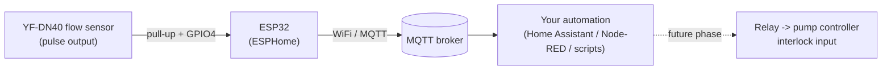
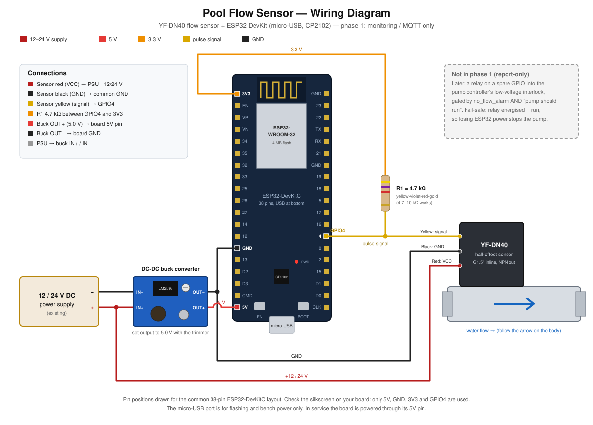

# Pool Filtration Flow Monitor

Monitors water flow through a swimming pool filtration system using a
**YF-DN40** hall-effect flow sensor and an **ESP32**, and reports live
readings to **MQTT**. The goal: know at a glance (and via alerts) whether the
pump is actually circulating water, and catch a no-flow condition — dry
running, a closed valve, a clogged strainer — before it damages the pump.

**Status**: phase 1, monitoring/reporting only. The device does not switch
the pump itself; it publishes a `no_flow_alarm` you combine with your own
automation (Home Assistant, Node-RED, etc.) and the pump's own on/off state
to decide when to act. See [Future enhancements](#future-enhancements) for
the path to automatic cutoff.

## Architecture



**Firmware: [ESPHome](https://esphome.io/)**, chosen over a hand-rolled
Arduino/PlatformIO sketch or MicroPython because it gives us, essentially for
free, in a single readable YAML file:

- A `pulse_meter` sensor platform built specifically for pulse-output flow/gas
  meters, using the ESP32's hardware pulse counting — accurate at the YF-DN40's
  2–68 Hz output range without hand-written interrupt code.
- Built-in MQTT client (no Home Assistant required), WiFi reconnection, OTA
  updates, and a local web status page — all things a bare Arduino sketch
  would need writing and maintaining by hand.
- Configuration you can tune (GPIO pin, no-flow threshold, WiFi/MQTT
  credentials) by editing YAML, not C++.

## Bill of materials

| Qty | Component | Notes |
|---|---|---|
| 1 | YF-DN40 water flow sensor | G1.5" inline, hall-effect / NPN open-collector pulse output. Already owned. |
| 1 | ESP32 dev board (e.g. ESP32-DevKitC) | Micro-USB with onboard USB-UART chip and 5V→3.3V regulation. |
| 1 | DC-DC buck converter, adjustable, set to 5.0V output (e.g. LM2596 module) | Steps your existing 12V/24V DC supply down to 5V for the ESP32's 5V/VIN pin. |
| 1 | Pull-up resistor, 4.7 kΩ–10 kΩ, 1/4W | Pulls the sensor's open-collector signal line up to 3.3V logic level. |
| 1 | IP65-or-better enclosure with cable glands | Pool equipment rooms are humid; a bare dev board won't survive long. |
| 1 | Terminal blocks (DIN rail or screw-terminal breakout) | For 12/24V, GND, and sensor wiring — avoid twisted bare wires in a wet area. |
| — | Hookup wire (22 AWG or per local code); shielded twisted pair recommended for the signal run | Especially if the cable is routed near the pump motor or contactor. |
| 1 | 12V or 24V DC supply | You already have this at the equipment pad. |
| Optional | TVS diode (e.g. SMBJ5.0A) on the signal line | Extra transient/noise protection; not strictly required. |
| Future phase | Relay/SSR module compatible with your pump controller's low-voltage interlock input | Only needed if/when you add automatic pump cutoff — see [Future enhancements](#future-enhancements). |

## Wiring



The diagram shows the board as it is: a 38-pin ESP32-DevKitC style board
(classic ESP32, CP2102 USB-UART chip, micro-USB at the bottom). Pin positions
follow the common DevKitC layout. Check the silkscreen on your board before
wiring: only four pins are used.

| From | To | Note |
|---|---|---|
| DC supply **+** | Sensor **red** (VCC) and buck **IN+** | The sensor accepts 3.5–24V and draws about 15 mA. |
| DC supply **−** | Buck **IN−** | Same net as every GND below. |
| Buck **OUT−** | Board **GND** (left header, 14th pin from the top) | Set the buck output to 5.0V with its trimmer before connecting the board. |
| Buck **OUT+** | Board **5V** pin (left header, bottom) | Not the 3V3 pin. The board's regulator makes 3.3V. |
| Sensor **black** (GND) | Common GND | Joins the DC supply − and the board GND. |
| Sensor **yellow** (signal) | Board **GPIO4** (right header, 13th pin from the top) | Open-collector output, idle high, pulled low per pulse. |
| **R1** 4.7 kΩ (4.7–10 kΩ works) | Between GPIO4 and board **3V3** (left header, top) | Required pull-up, whatever the sensor supply voltage is. |

- **Power while testing:** the micro-USB port powers and flashes the board on
  the bench. In service, power it through the 5V pin. Do not connect USB and
  the buck output to the board at the same time unless your board has a
  diode on its 5V rail. Check this first.
- The first and last header pins of your board may be labelled differently
  (for example `VIN` instead of `5V`). The function is the same.
- Double-check the **flow-direction arrow** printed on the sensor body when
  plumbing it in-line.
- Keep the AC/mains side of anything (if you later add pump switching)
  physically separated from this low-voltage wiring, in its own enclosure
  section or a separate enclosure entirely.

## MQTT topics

Broker, prefix, and credentials are all set in `esphome/secrets.yaml` (see
[Setup](#setup)). With the default `topic_prefix: pool/flow-sensor`:

| Topic | Payload | Notes |
|---|---|---|
| `pool/flow-sensor/status` | `online` / `offline` | Retained availability (MQTT LWT). Subscribe to this to know if the device itself has dropped off, as distinct from a real no-flow condition. |
| `pool/flow-sensor/flow_rate` | float, L/min | Updates on each pulse; reports `0` if no pulse for 15s. |
| `pool/flow-sensor/average_flow_3s` | float, L/min | 3-second moving average of `flow_rate`, updated once per second. Smooths out per-pulse jitter — better suited to dashboards/graphs than the raw `flow_rate`. |
| `pool/flow-sensor/total_volume` | float, L | Cumulative since last boot/OTA — **does not persist across power loss**, see [Future enhancements](#future-enhancements). |
| `pool/flow-sensor/no_flow_alarm` | `ON` / `OFF` | `ON` after flow stays below 1.0 L/min for 30 seconds straight. Report-only — your automation decides what to do with it. |
| `pool/flow-sensor/wifi_signal` | int, dBm | Diagnostic. |
| `pool/flow-sensor/uptime` | int, seconds | Diagnostic — a reset without a corresponding `offline`/`online` blip can indicate brownouts/crashes. |

A local status page is also available at `http://pool-flow-sensor.local/` (or
its IP) for a quick check without an MQTT client.

## Setup

1. Install ESPHome (a Python virtualenv is recommended):

   ```bash
   python3 -m venv .venv
   source .venv/bin/activate
   pip install esphome
   ```

2. Copy the secrets template and fill in your WiFi/MQTT details:

   ```bash
   cp esphome/secrets.yaml.example esphome/secrets.yaml
   ```

   Generate a real API encryption key (required by ESPHome's `api:`
   component even though this project doesn't require Home Assistant):

   ```bash
   openssl rand -base64 32
   ```

   Paste the result into `api_encryption_key` in `esphome/secrets.yaml`, and
   pick your own strong values for `ota_password` and `ap_fallback_password`.

3. Validate the config (catches typos/schema issues before flashing):

   ```bash
   esphome config esphome/water-flow-sensor.yaml
   ```

4. First flash, over USB, with the board connected via its USB port:

   ```bash
   esphome run esphome/water-flow-sensor.yaml
   ```

5. Subsequent updates go out over the air automatically — run the same
   `esphome run` command again once the device is on WiFi; ESPHome finds it
   via mDNS.

6. Check it's reporting, e.g. with `mosquitto_sub`:

   ```bash
   mosquitto_sub -h <broker> -u <user> -P <password> -t 'pool/flow-sensor/#' -v
   ```

## Tuning

Edit the `substitutions:` block at the top of
`esphome/water-flow-sensor.yaml`:

| Key | Default | Purpose |
|---|---|---|
| `flow_pulse_pin` | `GPIO4` | Change if you wire the sensor to a different pin. |
| `no_flow_threshold_lpm` | `1.0` | Flow rate (L/min) below which "no flow" is considered true. |
| `no_flow_delay` | `30s` | How long low flow must persist before `no_flow_alarm` fires — avoids false alarms from priming/air-purge transients. |
| `average_sample_interval` | `1s` | Bucket size the raw `flow_rate` is averaged into before the moving average is computed. |
| `average_window_size` | `3` | Number of buckets the moving average spans. Duration = `average_sample_interval` × `average_window_size` (3s by default). |

If you ever swap in a different flow sensor model, update the two
`multiply: 0.037037` filter values (`1 / pulses-per-liter` — the YF-DN40's
`27` pulses/liter is derived from its datasheet pulse factor
`F(Hz) = 0.45 × Q(L/min)`).

## Future enhancements

Not built in phase 1, but the design leaves room for:

- **Automatic pump cutoff.** Add a relay/SSR driven from a spare ESP32
  GPIO into your pump controller's existing low-voltage interlock input,
  gated on `no_flow_alarm` **and** "pump expected to be running" (so the
  pump being off on schedule isn't treated as a fault). Wire it fail-safe:
  relay energized = pump permitted to run, so loss of ESP32 power also stops
  the pump.
- **Persistent total volume.** The current `total_volume` sensor resets on
  reboot/OTA. A true lifetime total needs either flash-backed state on the
  ESP32 (an ESPHome `globals` + `preferences` pattern) or simply summing the
  MQTT values on the consumer side (Home Assistant's own long-term
  statistics, for instance).
- **Home Assistant MQTT discovery.** Flip `mqtt.discovery` to `true` and add
  a `device:` block if you adopt Home Assistant later — no other changes
  needed.

## Troubleshooting

- **No pulses / flow_rate stuck at 0 with the pump running**: check the
  pull-up resistor is actually wired between GPIO4 and 3V3, and that the
  sensor's flow-direction arrow matches actual flow.
- **Erratic/jumpy flow_rate at low flow**: increase `internal_filter` in the
  YAML slightly (default `5ms`) if you suspect electrical noise, or move the
  signal cable away from pump motor/contactor wiring.
- **Device shows `offline` in MQTT unexpectedly**: check WiFi signal
  (`wifi_signal` topic) and that the fallback AP hasn't activated (device
  couldn't reach your WiFi) — connect to `<friendly_name> Fallback` to
  reconfigure.
- **`esphome run` can't find the board over USB**: some ESP32 boards need
  the BOOT button held while plugging in, or immediately after starting the
  flash command, to enter the bootloader.
